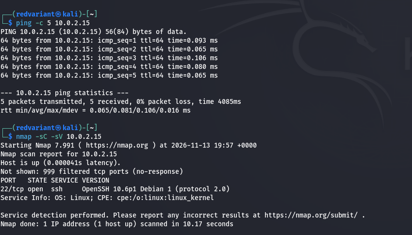

Note: This process was split between 2 days and the output of initial-network-recon.png results shows virtual-box's internal network interface may have been connecting to a different host or network path. as for the newer scans where eth0 did not have an IPv4 address, this was when i realised the virtual box did not have a DHCP server configured. I have used the image of nmap scan as I did not have a screen shot of the terminal from the previous day.
---------------------------------------------------------------------------------------------------------------------------------------------------------
As you can see nmap found only one open port, raising the possibility of a network configuration issue with either the Metasploitable VM or VirtualBox, i realised that the metasploitable vm is supposed to have numerouse open and exploitable ports hence how i came to the conclusion there may be an network issue. I traced the problem to the VirtualBox Internal Network: it did not have a DHCP server configured. I added one from the host terminal using the command below, which assigned addresses to the VMs on the “pentest” network.
```bash
VBoxManage dhcpserver add --network="pentest" --server-ip=192.168.56.2 --netmask=255.255.255.0 --lower-ip=192.168.56.10 --upper-ip=192.168.56.100 --enable
```


Before configuration, eth0 had no IPv4 address. eth1 had an IPv4 address, but it was not on the intended lab subnet, so it wasn’t the interface I planned to use.
```bash
ifconfig
eth0: flags=4163<UP,BROADCAST,RUNNING,MULTICAST>  mtu 1500
        ether 08:00:27:2d:02:59  txqueuelen 1000  (Ethernet)
        RX packets 0  bytes 0 (0.0 B)
        RX errors 0  dropped 0  overruns 0  frame 0
        TX packets 0  bytes 0 (0.0 B)
        TX errors 0  dropped 0 overruns 0  carrier 0  collisions 0

eth1: flags=4163<UP,BROADCAST,RUNNING,MULTICAST>  mtu 1500
        inet 10.0.3.15  netmask 255.255.255.0  broadcast 10.0.3.255
        inet6 fe80::a00:27ff:fe46:52a0  prefixlen 64  scopeid 0x20<link>
        inet6 fd17:625c:f037:3:a00:27ff:fe46:52a0  prefixlen 64  scopeid 0x0<global>
        inet6 fd17:625c:f037:3:7d27:6afc:9389:54ff  prefixlen 64  scopeid 0x0<global>
        ether 08:00:27:46:52:a0  txqueuelen 1000  (Ethernet)
        RX packets 20  bytes 5003 (4.8 KiB)
        RX errors 0  dropped 0  overruns 0  frame 0
        TX packets 39  bytes 5644 (5.5 KiB)
        TX errors 0  dropped 0 overruns 0  carrier 0  collisions 0

lo: flags=73<UP,LOOPBACK,RUNNING>  mtu 65536
        inet 127.0.0.1  netmask 255.0.0.0
        inet6 ::1  prefixlen 128  scopeid 0x10<host>
        loop  txqueuelen 1000  (Local Loopback)
        RX packets 88  bytes 6960 (6.7 KiB)
        RX errors 0  dropped 0  overruns 0  frame 0
        TX packets 88  bytes 6960 (6.7 KiB)
        TX errors 0  dropped 0 overruns 0  carrier 0  collisions 0
```


--------------------------------------------------------------------------------------------------------------------------------

Below is the output showing kali linux vm's eth0 interface successfully obtain IPv4 address through the DHCP server configured on virtual box's internal network.
```bash
ifconfig
eth0: flags=4163<UP,BROADCAST,RUNNING,MULTICAST>  mtu 1500
        inet 192.168.56.10  netmask 255.255.255.0  broadcast 192.168.56.255
        inet6 fe80::a00:27ff:fe2d:259  prefixlen 64  scopeid 0x20<link>
        ether 08:00:27:2d:02:59  txqueuelen 1000  (Ethernet)
        RX packets 3  bytes 1770 (1.7 KiB)
        RX errors 0  dropped 0  overruns 0  frame 0
        TX packets 16  bytes 1926 (1.8 KiB)
        TX errors 0  dropped 0 overruns 0  carrier 0  collisions 0

eth1: flags=4163<UP,BROADCAST,RUNNING,MULTICAST>  mtu 1500
        ether 08:00:27:46:52:a0  txqueuelen 1000  (Ethernet)
        RX packets 57  bytes 10285 (10.0 KiB)
        RX errors 0  dropped 0  overruns 0  frame 0
        TX packets 76  bytes 9210 (8.9 KiB)
        TX errors 0  dropped 0 overruns 0  carrier 0  collisions 0

lo: flags=73<UP,LOOPBACK,RUNNING>  mtu 65536
        inet 127.0.0.1  netmask 255.0.0.0
        inet6 ::1  prefixlen 128  scopeid 0x10<host>
        loop  txqueuelen 1000  (Local Loopback)
        RX packets 88  bytes 6960 (6.7 KiB)
        RX errors 0  dropped 0  overruns 0  frame 0
        TX packets 88  bytes 6960 (6.7 KiB)
        TX errors 0  dropped 0 overruns 0  carrier 0  collisions 0
```
After configuration results, you can see 23 ports open compared to the initial output.
nmap scan after.
```bash
nmap -sV -sS 192.168.56.11
Starting Nmap 7.991 ( https://nmap.org ) at 2026-11-15 13:34 +0000
Unable to determine any DNS servers. . Falling back to --system-dns. Specify valid servers with --dns-servers
Nmap scan report for 192.168.56.11
Host is up (0.000064s latency).
Not shown: 977 closed tcp ports (reset)
PORT     STATE SERVICE     VERSION
21/tcp   open  ftp         vsftpd 2.3.4
22/tcp   open  ssh         OpenSSH 4.7p1 Debian 8ubuntu1 (protocol 2.0)
23/tcp   open  telnet      Linux telnetd
25/tcp   open  smtp        Postfix smtpd
53/tcp   open  domain      ISC BIND 9.4.2
80/tcp   open  http        Apache httpd 2.2.8 ((Ubuntu) DAV/2)
111/tcp  open  rpcbind     2 (RPC #100000)
139/tcp  open  netbios-ssn Samba smbd 3.X - 4.X (workgroup: WORKGROUP)
445/tcp  open  netbios-ssn Samba smbd 3.X - 4.X (workgroup: WORKGROUP)
512/tcp  open  exec        netkit-rsh rexecd
513/tcp  open  login       OpenBSD or Solaris rlogind
514/tcp  open  shell       Netkit rshd
1099/tcp open  java-rmi    GNU Classpath grmiregistry
1524/tcp open  bindshell   Metasploitable root shell
2049/tcp open  nfs         2-4 (RPC #100003)
2121/tcp open  ftp         ProFTPD 1.3.1
3306/tcp open  mysql       MySQL 5.0.51a-3ubuntu5
5432/tcp open  postgresql  PostgreSQL DB 8.3.0 - 8.3.7
5900/tcp open  vnc         VNC (protocol 3.3)
6000/tcp open  X11         (access denied)
6667/tcp open  irc         UnrealIRCd
8009/tcp open  ajp13       Apache Jserv (Protocol v1.3)
8180/tcp open  http        Apache Tomcat/Coyote JSP engine 1.1
MAC Address: 08:00:27:E0:5A:3D (Oracle VirtualBox virtual NIC)
Service Info: Hosts:  metasploitable.localdomain, irc.Metasploitable.LAN; OSs: Unix, Linux; CPE: cpe:/o:linux:linux_kernel

Service detection performed. Please report any incorrect results at https://nmap.org/submit/ .
Nmap done: 1 IP address (1 host up) scanned in 11.93 seconds
```
summary:
This troubleshooting took place over two days. My initial scan showed one open port, but it may have reached a different host or network path, so I treated it as a clue. The following day, I found that the Pentester VM’s eth0 interface had no IPv4 address on the intended pentest Internal Network. I configured a VirtualBox DHCP server for that network. Afterward, eth0 received 192.168.56.10, and I could scan Metasploitable at 192.168.56.11. The scan found 23 open TCP ports in Nmap’s scan.

